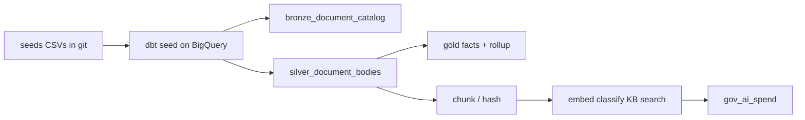

# Deploy Folio on dbt Cloud + BigQuery

**Demo path:** keep the in-repo **seeds** (catalog + Docling markdown). No GCS / BigLake /
zero-copy required. dbt Cloud loads seeds into BigQuery, then builds medallion + context
engineering. Turn on AI when you want real `AI.EMBED` / `AI.GENERATE`.



## 0. Push this repo

dbt Cloud builds from git. From the project root:

```bash
git add -A
git commit -m "Initial Folio demo for dbt Cloud + BigQuery"
# create a GitHub/GitLab remote, then:
git push -u origin HEAD
```

(Do not commit service-account JSON keys or `.env`.)

## 1. GCP

1. GCP project with **BigQuery API** + **Vertex AI API** enabled.
2. Service account (e.g. `dbt-folio`) with:
   - BigQuery Job User  
   - BigQuery Data Editor  
   - BigQuery Read Session User (recommended)
3. Download a JSON key — store locally, never in git.
4. Use one location (e.g. `US`) for the dataset and Vertex.

Scheduled (non-interactive) jobs may need a Vertex Cloud Resource Connection and
`bq_connection` in job vars. IDE / interactive runs often work without it.

## 2. dbt Cloud project

1. **New project** → warehouse **BigQuery** → upload the SA JSON.
2. Developer credentials → dataset `folio_dev` (or `dbt_<you>`), location `US`, threads ~4–6.
3. **Connect repository** → select this Folio repo (project root = where `dbt_project.yml` lives).
4. dbt version **≥ 1.12** (needed for root [`vars.yml`](../vars.yml)).
5. In the Studio IDE:

```bash
dbt deps
dbt build
```

That loads seeds into BigQuery and builds Bronze → Silver → Gold + hashed chunks.
AI models stay off (`ai_functions_enabled: false`).

## 3. Job with AI + cost gates

Create a dbt Cloud job (e.g. `folio-bq-ai`) with commands:

```bash
dbt deps
dbt build --vars '{"ai_functions_enabled": true}'
```

Optional Vertex connection for scheduled runs:

```bash
dbt build --vars '{"ai_functions_enabled": true, "bq_connection": "us.folio_vertex"}'
```

Ceilings already in [`vars.yml`](../vars.yml) (`max_batch_rows`, `max_est_tokens`,
`max_output_tokens`, `bq_thinking_budget`, `cost_per_1k_tokens`, `allow_full_reembed`).
Demo corpus is ~10 docs — expect a small Vertex bill.

| Models (BQ) | Role |
|---|---|
| `text-embedding-005` | `embed()` |
| `gemini-3.5-flash` | `classify()` / generate |

If Vertex returns “Publisher model … was not found”, switch `model_classify` / `model_generate` in [`vars.yml`](../vars.yml) to another ID from the [AI.GENERATE docs](https://cloud.google.com/bigquery/docs/reference/standard-sql/bigqueryml-syntax-ai-generate) (e.g. `gemini-3.5-flash-lite`, `gemini-3.8-flash`) or enable model access in the GCP project.

## 4. Verify in BigQuery Studio

Replace project/dataset:

```sql
select * from `YOUR_PROJECT.folio_dev.bronze_document_catalog`;
select doc_id, quality_score, sensitivity_label, silver_status
from `YOUR_PROJECT.folio_dev.silver_document_bodies`;
select * from `YOUR_PROJECT.folio_dev.gold_account_risk_rollup`
order by risk_docs desc;

-- after the AI job
select * from `YOUR_PROJECT.folio_dev.search` limit 20;
select * from `YOUR_PROJECT.folio_dev.gov_ai_spend`;
```

## 5. What stays local-only

| Piece | Cloud? |
|---|---|
| Seeds + all dbt models | Yes — BigQuery |
| `bronze/documents/*.pdf` | In git for the story; warehouse uses seed catalog URIs as strings |
| Streamlit `make dashboard` | Local DuckDB only; use BigQuery / Looker on `gov_*` in Cloud |

## Troubleshooting

| Symptom | Fix |
|---|---|
| `embed` / `classify` compiler error about AI disabled | Pass `ai_functions_enabled: true` in the job/IDE vars |
| Vertex / permission errors on AI models | Enable Vertex AI API; check SA roles; set `bq_connection` for scheduled jobs |
| `guard_batch` ceiling tripped | Demo ceilings are tight on purpose; raise `max_batch_rows` / `max_est_tokens` only if intentional |
| dbt version / `vars.yml` ignored | Set Cloud environment to dbt ≥ 1.12 |
